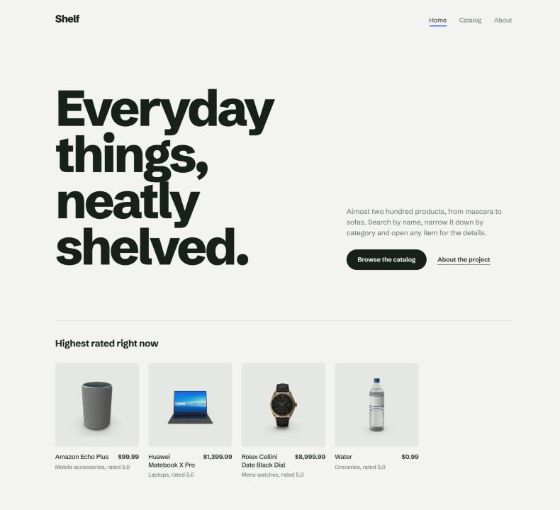
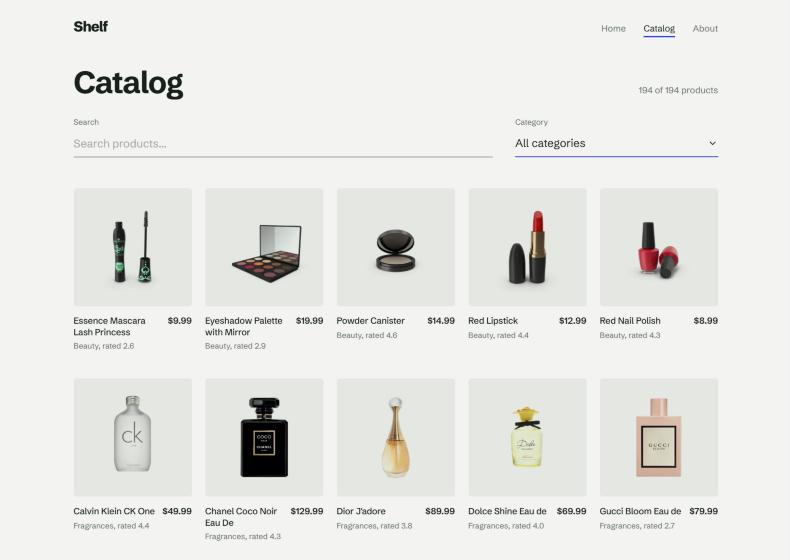
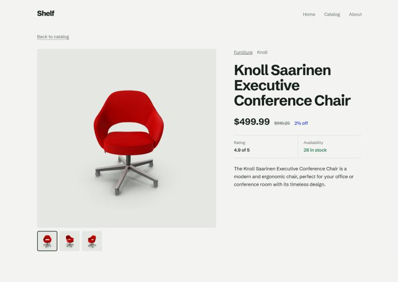
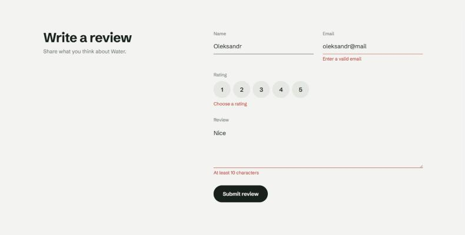
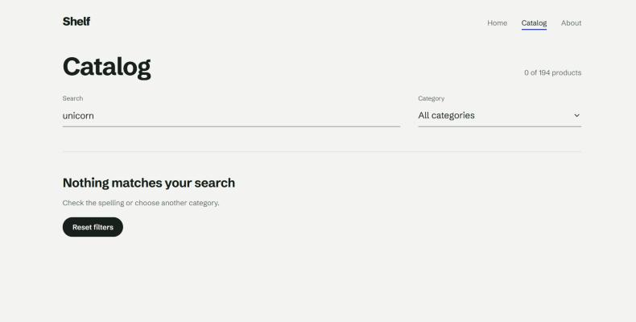
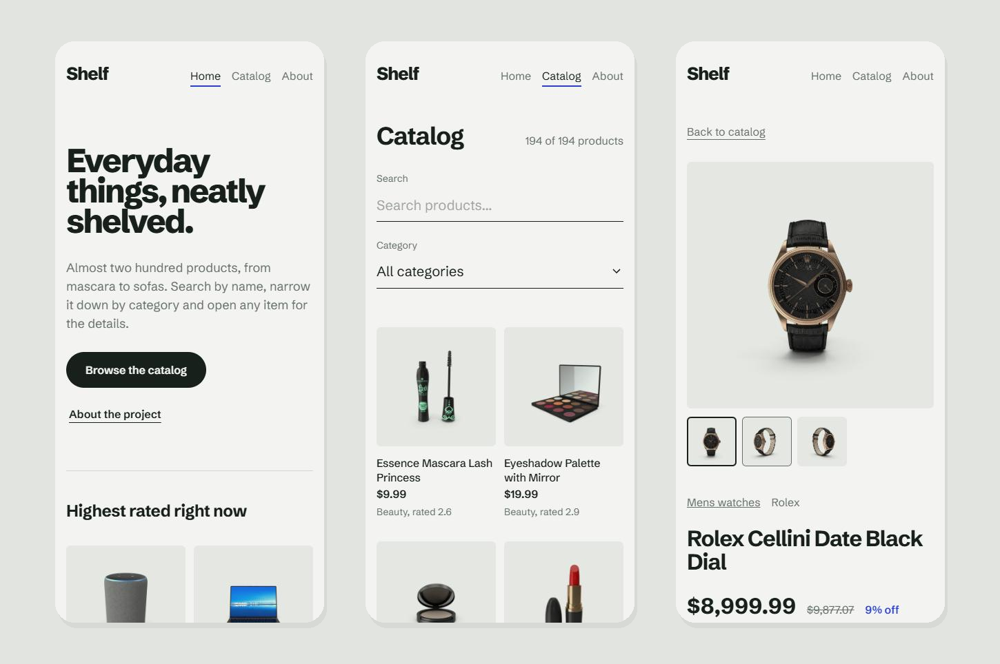

# Shelf — product catalog

A single-page product catalog built with React and TypeScript. Almost two hundred products from the public DummyJSON API, with search, category filters, product pages and a validated review form.

**[Live demo](https://react-product-catalog-ecru.vercel.app)** · Design and development by [Oleksandr Vyshnevskyi](https://vyshnevsky.com)




| Catalog | Product page |
| --- | --- |
|  |  |
| **Review form** | **Nothing found** |
|  |  |

**On a phone**



## Highlights

- Typed end to end: TypeScript in strict mode, no `any`, form types inferred from the Zod schema
- A reusable, generic `useFetch` hook that cancels outdated requests
- Every screen has a loading, error and empty state
- Accessible review form with inline validation messages
- Responsive layout in plain CSS Modules, no UI libraries

## What it does

- **Home.** A short intro and the four highest-rated products, picked from the live data.
- **Catalog.** The full product list with search by name and a category filter. A counter shows how many products match, and an empty state offers a one-click reset.
- **Product page.** Opens at `/item/:id` with an image gallery, price with discount, rating and stock status. A missing product shows a friendly error with a link back to the catalog.
- **Review form.** Name, email, a 1–5 rating and a comment, validated with React Hook Form and Zod. Errors appear after a field is touched, invalid fields are marked with `aria-invalid`, and the form resets after sending. Changing the product resets the form through `key`.
- **About and 404.** A short project page and a not-found page for unknown routes.

## Stack

- [React 19](https://react.dev/) + [TypeScript](https://www.typescriptlang.org/) in strict mode
- [Vite](https://vite.dev/) for development and builds
- [React Router](https://reactrouter.com/) with nested routes and a shared layout
- [React Hook Form](https://react-hook-form.com/) + [Zod](https://zod.dev/) for the review form
- CSS Modules for styles, self-hosted Schibsted Grotesk variable font
- ESLint with typescript-eslint and react-hooks rules
- [Vercel](https://vercel.com/) for hosting, with an SPA rewrite so deep links like `/item/5` work on refresh

## How data loading works

All requests go through one small API client and a generic hook:

```ts
const { data, loading, error } = useFetch(getProducts)
```

- `useFetch<T>` takes a fetcher function and returns `data / loading / error`, typed by the fetcher.
- Every request gets an `AbortController`. When the page or product id changes, the previous request is cancelled, so a slow old response can never overwrite a new one.
- The loading flag is derived from state instead of being stored separately, which keeps it in sync without extra effects.

## Accessibility

- Semantic landmarks and one `h1` per page
- Every form field has a visible label, the rating uses `fieldset` and `legend`
- Invalid fields are marked with `aria-invalid`, the success message uses `role="status"`
- Gallery thumbnails are buttons with `aria-label` and `aria-pressed`
- Visible focus states and enough colour contrast

## Project structure

```
src/
  api/          API client and request functions
  types/        TypeScript types for API data
  hooks/        useFetch
  components/   reusable components (cards, grid, gallery, search, filter, review form)
    ui/         Loader, ErrorMessage, EmptyState
  layouts/      RootLayout with header, footer and outlet
  pages/        Home, Catalog, Product, About, 404
  utils/        price and category formatting
  router.tsx    route configuration
vercel.json     SPA rewrite for client-side routes
```

## Scripts

```bash
npm install
npm run dev       # local dev server
npm run build     # type-check and production build into dist/
npm run preview   # serve the build locally
npm run lint      # ESLint
```

## What I learned

- Designing a reusable data-fetching hook with generics and cancelling stale requests
- Deriving state instead of duplicating it (filtered list, counters, loading flag)
- Building schema-validated forms where the TypeScript types come from the schema
- Resetting component state with `key` when the route changes
- Making client-side routing work on a static host

## Roadmap

- Runtime validation of API responses with Zod
- Pagination and sorting
- Unit tests with Vitest and Testing Library

## Credits

- **Data and product images:** [DummyJSON](https://dummyjson.com), a free fake REST API for testing and prototyping.
- **Font:** Schibsted Grotesk, under the SIL Open Font License 1.1, via Fontsource.
- **Design and development:** [Oleksandr Vyshnevskyi](https://vyshnevsky.com).

Shelf is a learning project. Products, prices and reviews are demo data and nothing is for sale.
